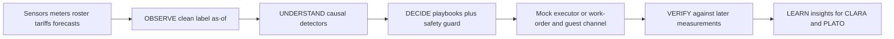

# PLATO-40 learning loop

What a short replay of the fictional PLATO-40 hotel suggests for **CLARA** (how to operate next year) and **PLATO** (what to design differently next time), plus a target architecture.

Evidence below comes from the 21-day quickstart (5–25 Jan 2026) and from the decisions the pipeline emitted on that run. The quickstart, the 365-day dev set and the holdout are independent synthetic runs. Anything that needs a full year is marked as a hypothesis, not a finding. Simulated savings are labelled as simulated. Nothing here claims a measured energy or cost result.

## Recommendations for CLARA

### 1. Do not treat a missing filter-pressure reading as a worn filter

**Recommendation.** Split ventilation maintenance into two cases. A rising `AHU1.filter_dp_pa` on valid samples is a service candidate. A blank run is a sensor-gap flag. Only escalate the gap to a filter change when a second signal agrees (airflow below its usual schedule while fan power is up).

**Evidence.** On the quickstart, filter pressure is blank from about 16 Jan 22:30 to 21 Jan 03:15, in the middle of a rising trend. The detector records that gap as data quality and cites the last valid level only as context. Later, on 20–22 Jan, it raises maintenance from airflow and fan power because the pressure sensor is still missing, and it asks for a contractor because TECH_1 is on vacation.

**Uncertainty.** One three-week run. The "usual airflow" baseline is learned from this dataset, not from a labelled fault library.

**How to verify.** After a real (or replayed) filter change, `filter_dp_pa` on valid samples should fall toward the early-run baseline, and airflow should recover without a matching drop in fan power. If the sensor stays blank, do not close the work order.

### 2. Schedule the technician from the roster that is known at decision time

**Recommendation.** Never book TECH_1 on a shift already known to be sick or vacation. If the next in-house slot is after the fault is already severe, request an external contractor and say so in the reason. Re-check when `status_known_utc` updates.

**Evidence.** Filter pressure is already about 1.15× baseline on 14 Jan, with a slot on 15 Jan. Once the 15 Jan sick status is known, the slot moves to 16 Jan. By 20 Jan TECH_1 is on vacation (19–23 Jan) and the action names an external contractor. The technician shift in `building.json` is 08:00–16:30 local, Monday–Friday, and there is one in-house technician.

**Uncertainty.** The quickstart has a single technician. A building with a backup tech would not need the contractor branch as often.

**How to verify.** No `dispatch_technician` timestamp should fall inside a sick or vacation interval that was already known. A completed work order, not the dispatch itself, is what clears the incident.

### 3. Clean only when the turnaround is actually tight, and tell the guest a time you can keep

**Recommendation.** Skip routine checkouts that still have hours of slack. Always schedule cleaning when a guest is waiting, asked for early check-in, or the projected ready time misses the arrival. Put that projected time in `notify_guest`. Do not treat the message as delivered.

**Evidence.** The turnaround detector uses the median past cleaning duration, the dirty-room queue, and cleaners who are `scheduled` (not `sick`) as of that moment. On 24 Jan, CLEANER_1 is sick and the weekend plan reports an unmet gap (about 12 turnovers against about 8 rooms of staffed capacity). On-call cover is optional and limited: one person, 15:30–22:00 local, one room at a time, waiting guests only.

**Uncertainty.** The 6 Jan surge is partly an edge effect: the bookings file only contains stays that reach into the quickstart window, so the early baseline is thin.

**How to verify.** A room is ready only when `housekeeping_state` is `clean` before the promised time. If slack goes negative, escalate; do not release the room.

### 4. Order waste and vending before the regular slot, using the real lead time

**Recommendation.** Project fill or stock to the next scheduled service (waste: Tue and Fri 07:00 local; vending: Mon and Thu 10:00 local). Order an extra pickup or restock only when the 24-hour lead time still beats that slot. If the lead time already misses it, ask a human instead of pretending an order will arrive in time.

**Evidence.** On 25 Jan the central container `WASTE_MAIN` is about 75% full and rising fast enough that the next pickup (27 Jan) is projected past 100%. The 24-hour lead time cannot land before that pickup, so the decision is an urgent service order, not a quiet schedule change. Floor bins at the 100% cap are treated as "may be overflowing", not as a precise measurement.

**Uncertainty.** One overflow projection in three weeks. Event weekends on the dev year may be worse; that is still a hypothesis.

**How to verify.** After a pickup event, `fill_pct` should drop. If it does not, the order did not happen.

### 5. Shift the battery only when the day-ahead price actually spreads, and never against comfort

**Recommendation.** Propose charge/discharge at most once per local day, only after the tariff is published, and only when the cheap-to-expensive spread is material. If any occupied room is already below the comfort floor, defer the shift.

**Evidence.** On the quickstart the energy detector emits about one candidate per day. Most of those days are marked comfort-at-risk and the safety guard turns `optimize_energy` into `defer_action`. Only a couple of days stay as an autonomous shift. The euro figure on a battery plan is stored as a simulated estimate, not a meter reading.

**Uncertainty.** Discharge is capped using yesterday's load as a stand-in for tomorrow. Winter quickstart days are cold, so deferral dominates; a mild week would look different.

**How to verify.** Occupied rooms stay inside 20–23 °C. Do not book the simulated euro figure as a saving.

## Recommendations for PLATO

### 1. Do not design the next building around one technician and one filter sensor

**Finding.** AHU filter health disappears for days, and the only in-house technician is unavailable across that same window (sick, then vacation).

**Recommendation.** Give the air handler a second way to see filter load (a maintained dp sensor, plus airflow and fan power that are logged even when dp is blank). Plan a second maintenance path (contractor on a standing agreement, or a second tech) so a vacation week is not a blind week.

**Uncertainty.** This is one January window. Confirm on the dev year how often the dp gap and the technician absence overlap.

### 2. Size housekeeping and waste for a full hotel, not an average Tuesday

**Finding.** The quickstart reaches 40/40 occupancy with a same-day turnover load that two or three cleaners cannot clear once one calls in sick. Robots shorten floor work but cannot clean bathrooms or release a room. The central waste container is already on track to overflow before the Friday pickup.

**Recommendation.** Either staff a surge roster that is real (named people, known before the weekend) or cap sellable same-day turns. Size `WASTE_MAIN` for an event weekend, or keep a contracted extra pickup that can actually arrive inside a day. Do not draw robot capacity as if it replaced a cleaner.

**Uncertainty.** The "event" is inferred from bookings versus the recent baseline. There is no separate event flag in the data.

### 3. Heating plant margin and a missing cooling mode are year-scale questions

**Hypothesis, not a result.** Occupied rooms go cold together in this January window while the heat pump reports lockout-type statuses, and the building has no cooling (`building.json`: heating-only heat pump, night flush in summer). Over a year, south-facing and top-floor rooms may overheat in summer, and the heat pump may be short in a cold snap.

**Recommendation.** On the 365-day set, compare hours outside 20–23 °C by orientation and floor, and heat-pump output against outdoor temperature. If summer hours above the band cluster by facade, that is a shading / ventilation design item. If winter output saturates while rooms stay cold, that is a capacity item. Do not write those as facts until that run is done.

### 4. Gateways and meters need a health signal

**Finding.** The observe stage already sees floor-wide dropouts, a frozen room sensor, an implausible temperature, duplicate rows, and a water-meter exchange that looks like a huge flow if you read the counter as a rate.

**Recommendation.** Put sensor health and meter-exchange events on the same timeline as the process value, and keep cumulative meters as counters. A future building should not make operations reconstruct a reset from a cliff in the totaliser.

## Target architecture

- **Data.** 15-minute room, water, plant and energy series; bookings and roster with the time each fact became known; day-ahead tariff `published_utc` and forecast `issued_utc`. Blank stays unknown.
- **Detectors.** Turnaround, water, comfort, sensor quality, filter maintenance, weekend capacity, logistics, energy shift. Each one only reads the as-of view.
- **Decide.** Playbooks propose. A deterministic guard enforces the never-rules: no uncleaned release, no robot bathroom or room release, setpoints for occupied rooms stay in 20–23 °C, no energy shift while comfort is at risk, costly actions need a person, occupied-room entry needs guest consent. Consent required is not consent granted.
- **Act.** Robots for floors and bin carries only. Humans certify rooms. Technician and contractor dispatch is an approval, not an autonomous actuation. Guest messages are drafts until a channel reports delivery.
- **Learn.** Recommendations stay tied to an evidence window and an uncertainty line. A simulated euro figure never becomes a measured saving.

## What this file is not

It is not a score on the holdout, and it is not a claim that the quickstart's January is a typical year. Re-run the same checks on the dev year before treating the plant-margin and summer-overheating items as design requirements.
